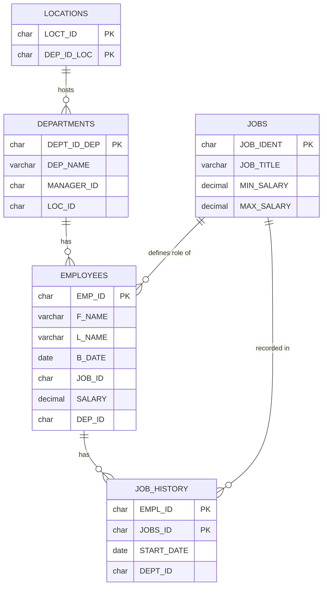

# HR Workforce & Departmental Analytics (MySQL)

A multi-table SQL project that designs a small HR database and answers workforce questions using joins, subqueries, aggregations and a salary audit.

> Built while learning from the IBM Data Analyst Professional Certificate (Databases & SQL for Data Science). The dataset is a small sample (10 employees), so the goal is to show SQL skills, not real company insights.

## Business questions answered

1. Which employees belong to Department 5 and when did they start?
2. What job title does each Department 5 employee hold?
3. Does every employee have a matching department?
4. Which departments have no employees (e.g. Data Analytics)?
5. What are the headcount, average salary and top salary per department?
6. Who earns more than the company average?
7. Is anyone paid outside the salary range of their job?

## Database design



The relationships above are logical (joined in queries). The tables do not declare `FOREIGN KEY` constraints.

## SQL concepts used

- `INNER JOIN`, `LEFT OUTER JOIN`, `RIGHT OUTER JOIN`
- FULL OUTER JOIN in MySQL using `LEFT JOIN ... UNION ... RIGHT JOIN`
- Conditions inside the `ON` clause vs the `WHERE` clause
- Subqueries (`WHERE SALARY > (SELECT AVG(SALARY) ...)`)
- `GROUP BY`, `COUNT`, `AVG`, `MAX`, `ROUND`
- `CASE` expressions, `CONCAT`, `YEAR()`

## Key findings

| Finding | Result |
|---|---|
| Highest average salary | Architect Group, about $86,667 (3 employees) |
| Software Group | Largest team, 4 employees, average $65,000 |
| Data Analytics department | 0 employees assigned (shows up only with an outer join) |
| Company average salary | $72,000 |
| Earning above company average | 3 employees (E1001, E1006, E1002) |
| Paid outside their job's salary range | 2 employees: E1006 (Data Analyst, $90,000, max $85,000) and E1004 (Jr. Designer, $60,000, max $50,000) |

## How to run

1. Install MySQL and MySQL Workbench (or any MySQL client).
2. Run `01_schema_and_data.sql` to create the `HR` database, tables and sample data.
3. Run the queries in `02_queries.sql` one at a time and compare with the findings above.

## Repository structure

```
hr-workforce-analytics-sql/
|-- README.md
|-- 01_schema_and_data.sql   # tables + sample data
|-- 02_queries.sql           # Q1-Q9 analysis queries
`-- screenshots/             # query output screenshots
```

## Author

Vinod Panchal | [LinkedIn](https://linkedin.com/in/vinod-panchal-497530316) | [GitHub](https://github.com/Vinod2605)
